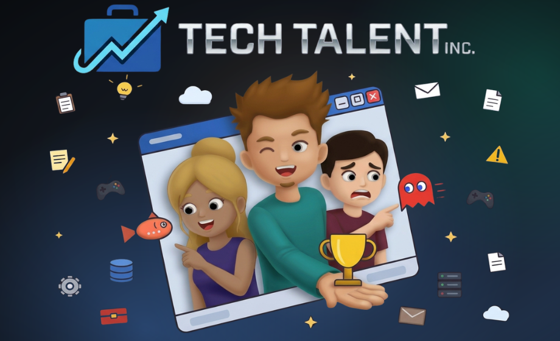

# Tech Talent Inc.

This is a management sim in the spirit of Game Dev Tycoon / Startup Company, except that you are the founder of a new tech consulting company, working from your personal computer.

Run marketing campaigns, bid on projects and accept work, hire employees and assign them to work by matching their skills to the required skills per project.

Bid, hire, deliver, publish, and build up the reputation of your company and employees.

## In consulting, the people are the product

You build your roster of expert consultants in various tech fields (database, programming, security, cloud, AI, and more), increase their reputation by publishing blog posts and webinars, and manage their morale and energy before they burn out!

But be careful: The more you build up your employees, the harder it gets to keep them in your company (everyone wants a reputable expert, and they're difficult to satisfy).

## Current State

- The game is currently **in development**.
- No playable version is available yet, but a demo will be coming soon.
- Follow this page to stay notified about updates!
- The game is built in Godot 4 and is supported on Windows, Linux, and MacOS.

### What's implemented:

- Support multiple game profiles on the same computer.
- Design your company's logo, and your founder's avatar and starting skills.
- Hiring, marketing, sales, and project management.
- 3 different project types: Regular paid project, subscription retainer project (with randomly created support tickets), and tailored training service.
- Investment work to create reputation-building content (blog posts, webinars, success stories, how-to guides, etc.).
- 13 different skill types, each with its own unique minigame, plus an "editor minigame" for creating content.
- Build your company's website and attract more leads by leveraging the content created.
- Office tiers and add-ons
- Light and Dark theme
- 3 difficulty levels

### Known limitations:

- Only two languages supported: English and Hebrew, but more will be added. Planned: French, Italian, Russian, Japanese, maybe more.
- No version compatibility between updates (game saves cannot be migrated yet).
- Some bugs here and there - always working to fix them as they come.

### What's planned:

- Playable demo (duh)
- Attending and sending employees to attend tech conferences
- Building and hosting tech conferences
- Building and managing B2C training courses
- Crafting managed subscription services
- "AI Assistant" to help employees with project work, including a crafting mechanic (i.e. "training the model")
- "Schedule a Meeting" mechanic to attend online calls with your employees and clients (RPG-like dialog trees, featuring a local text-to-speech model)
- "Big Whale" client "campaign/story" mechanic (huge client with a long-term contract)
- "Succession" end-game mechanic (hand-over your company to a successor to work independently and then create a new company)
- More avatar parts
- Digital Business Magazine featuring news about your company, your clients, and your rivals.

NOTE: Planned features may change.

## Links

- [Tech Talent Inc. - itch.io page](https://discoverace.itch.io/tech-talent-inc)

---

©️ Copyright 🚀 Discoverace Games, 2026

®️ All Rights Reserved

